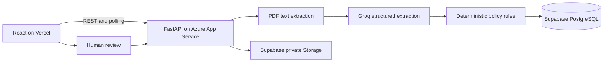

# Ledgerly - invoice exception workbench

PS-1 for the Zamp AI Solutions Analyst case study. Upload an invoice PDF, extract structured fields with Groq, compare against procurement records, and produce an evidence-backed AP decision. People approve; the application never initiates payments.

**Current state:** local browser-to-FastAPI-to-Groq-to-Supabase workflow verified. All four business scenarios passed, along with human approval, private file access, database enforcement, and persistence after restarting the API. Backend regression: 49 passed. An Azure Web App has been provisioned; public backend deployment and frontend deployment are not yet verified. See [milestones](docs/PROGRESS.md) and [live test results](docs/live-test-results.json).

## Reviewer walkthrough

- Start with [demo scenarios](sample_data/SCENARIOS.md): an eligible partial invoice, missing invoice number, duplicate invoice, and purchase-order overbilling. Sample PDFs use synthetic data.
- Read [business rules and tradeoffs](docs/DECISIONS.md) for the separation between AI extraction, deterministic validation, and human approval.
- Inspect [workflow orchestration](backend/app/workflow.py), [policy rules](backend/app/services/rules.py), and [database constraints and atomic approval](database/schema.sql).
- Explore the [React screens](frontend/src/pages) and [backend tests](backend/tests). The [live test report](docs/live-test-results.json) records the separate checks against real providers.
- Follow the setup steps below to run your own instance. Credentials are intentionally excluded; `.env.example` files document the required configuration.

## Stack and architecture

React + Vite + TypeScript + Tailwind + owned shadcn-style Button component -> FastAPI -> Groq + Supabase PostgreSQL/private Storage.



Features implemented: real stage events, decision evidence, duplicate checks, remaining-PO validation, dashboard/history/search, private document links, review records, and atomic approval function. Core flows were exercised through a local Chrome browser with real cloud providers. This is not completed public-production validation.

## Windows setup

Run from your cloned repository directory. The commands below use `E:\ZAMP_AI_ANALYST` as an example; substitute your checkout path. Python 3.13 and Node 22.12+ are suitable; this workspace was prepared with Python 3.13 and Node 24. Local `.env` files are ignored by Git. Do not paste or commit keys.

```powershell
cd E:\ZAMP_AI_ANALYST
python -m venv .venv
.\.venv\Scripts\python.exe -m pip install -r backend\requirements-dev.txt
npm.cmd ci --prefix frontend
```

On a fresh checkout, copy the examples, then generate and set two different random access codes:

```powershell
Copy-Item backend\.env.example backend\.env
Copy-Item frontend\.env.example frontend\.env
.\.venv\Scripts\python.exe -c "import secrets; print(secrets.token_urlsafe(24)); print(secrets.token_urlsafe(24))"
```

Do not run those copy commands over an environment file you have already configured.

In `backend/.env`, configure:

| Variable | Purpose |
|---|---|
| SUPABASE_URL | Your project HTTPS URL |
| SUPABASE_SERVICE_ROLE_KEY | Backend-only service-role JWT or server secret key |
| GROQ_API_KEY | Key in your Groq free-plan organization |
| GROQ_MODEL | Default `openai/gpt-oss-20b`, served through Groq; no separate OpenAI API account |
| DEMO_ACCESS_TOKEN | Shared demo access code |
| REVIEW_ACCESS_TOKEN | Different reviewer code |
| CORS_ORIGINS | Comma-separated allowed frontend origins |
| SUPABASE_STORAGE_BUCKET | `ap-invoices` |

The frontend needs only `VITE_API_URL`. Never put service-role, AI, or reviewer secrets in a `VITE_` variable.

## Supabase setup

1. Use a dedicated **Free** project if available. Do not upgrade the account or provision paid services.
2. In SQL Editor, run `database/schema.sql`, then `database/seed.sql`.
3. Schema creates five `ap_` tables, approval/dashboard functions, and private bucket `ap-invoices` (5 MB, PDF only).
4. RLS is enabled and direct anon/authenticated access is revoked. Backend service role performs authorized operations. No public storage policies are needed.
5. Run the setup check; it prints no credentials:

```powershell
.\.venv\Scripts\python.exe backend\scripts\check_setup.py
```

Table responsibilities: `ap_vendors` holds approved reference vendors; `ap_purchase_orders` holds gross limits and accepted balances; `ap_executions` holds inputs, outcomes, extraction, policy version and errors; `ap_stages` holds timestamps/statuses; `ap_reviews` holds human decisions. Approval uses a transaction, row locks, an identity advisory lock, and a unique approved-identity index.

## Run locally

Terminal 1, from repository root:

```powershell
.\.venv\Scripts\python.exe -m uvicorn app.main:app --app-dir backend --host 127.0.0.1 --port 8001
```

Terminal 2, from repository root:

```powershell
npm.cmd run dev --prefix frontend
```

Open http://localhost:5173. Enter `DEMO_ACCESS_TOKEN` from your local file. API health: http://localhost:8001/health; Swagger: http://localhost:8001/docs. The health endpoint reports configuration presence, not provider connectivity. `/api/readiness` checks the database; real invoice execution verifies AI access.

## Tests and demo inputs

```powershell
cd E:\ZAMP_AI_ANALYST\backend
..\.venv\Scripts\python.exe -m pytest -q
cd E:\ZAMP_AI_ANALYST
npm.cmd run build --prefix frontend
.\.venv\Scripts\python.exe backend\scripts\generate_samples.py
```

See `sample_data/SCENARIOS.md` for the ordered happy path and three edge cases. Unit tests mock external services; they do not establish live provider or SQL correctness. Public end-to-end validation and concurrent approval testing are separate gates.

## API

All `/api` routes require `Authorization: Bearer <demo code>`.

| Method/path | Purpose |
|---|---|
| GET /health | Process health and configuration presence |
| GET /api/readiness | Database connectivity |
| GET /api/dashboard | SQL-derived metrics and recent runs |
| POST /api/executions | Multipart PDF; returns 202 and persistent run ID |
| GET /api/executions | History with search, filters, offset |
| GET /api/executions/{id} | Extraction, stage events, checks, review history |
| GET /api/executions/{id}/document | Private PDF link valid for 120 seconds |
| POST /api/executions/{id}/reviews | approve/reject/request_info; requires X-Review-Token |
| GET /api/purchase-orders | Current reference POs and accepted balances |

Business outcomes: ready, needs_review, blocked. Execution statuses: running, completed, failed, interrupted. A completed workflow can legitimately require review. Quota failures never trigger a paid provider fallback.

## Deployment with zero out-of-pocket spending

1. Existing Azure student credits are authorized for backend hosting. Follow [Azure deployment](docs/AZURE_DEPLOYMENT.md) to verify credit coverage and the spending limit before provisioning. No pay-as-you-go upgrade.
2. Package the backend with `python scripts/package_backend.py` using the project virtual environment. Proposed host: Linux App Service Basic B1, Always On, one instance and one worker. Set credentials privately in Azure; never include `.env` in a deployment ZIP.
3. Push this repository to GitHub (repository creation and URL pending). On Vercel, use root `frontend`, framework Vite, build `npm run build`, output `dist`. Set `VITE_API_URL` to the verified Azure HTTPS URL. Verify Hobby eligibility for this personal case study.
4. Set Azure `CORS_ORIGINS` to the exact Vercel origin (no trailing slash); restart as needed when no workflows are active.
5. Test upload, real AI extraction, review, PO balance, history after backend restart, and private PDF access **through the public frontend**. Verify all sample scenarios; do not equate a passing localhost build with deployment success.
6. Check readiness before recording/interviewing. Supabase may pause inactive free projects; check before the interview. Stay within free quotas and monitor Azure credit consumption. The retained `render.yaml` is a free-tier fallback, not the selected host.

No public frontend/backend/Swagger/repository URL is claimed until actually created and tested.

## Limitations and next gates

- Text PDF extraction only; scans route to review, with no OCR success claim.
- No ERP, goods receipt, payment execution, legal tax validation, or verified vendor-registration lookup.
- No calibrated confidence scores; evidence and unresolved checks determine review.
- Shared demo/reviewer access is not multi-user identity verification. Use synthetic data only.
- In-process jobs are not durable; stale runs are marked interrupted after ten minutes. No automatic background retry, queue, or exactly-once execution guarantee.
- Source-quote existence does not prove that extracted values were interpreted correctly. Human approval remains required.
- Public deployment, simultaneous approval races, load behaviour, and deployment-specific access controls must still be verified. Quota failure handling was tested with a mock provider response; no intentional exhaustion of the shared free quota was attempted.

See `docs/DECISIONS.md` for business rules, assumptions, recovery, and illustrative ROI. Future improvements after the deadline: bounded OCR, authenticated reviewer identities, durable job processing, and procurement system integration.
