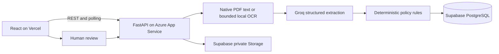

# Ledgerly - invoice exception workbench

PS-1 for the Zamp AI Solutions Analyst case study. Upload an invoice PDF, extract structured fields with Groq, compare against procurement records, and produce an evidence-backed AP decision. People approve; the application never initiates payments.

**Live demo:** [Ledgerly](https://ledgerly-ai-invoice-review.vercel.app/) · [API documentation](https://ledgerly-api-bobby-h3e4dnf4g3hsh9ej.centralindia-01.azurewebsites.net/docs) · [Source](https://github.com/rock917/ledgerly-ai-invoice-review)

**Current state:** the minimal layout, Light/Dark/System themes, review controls, and scanned-PDF OCR are deployed and verified through Vercel and Azure. A real image-only invoice completed in 35.7 seconds with all 11 rules passing and remains unapproved. Live browser checks passed against the real API. Backend regression: 59 passed. See [progress](docs/PROGRESS.md), [OCR verification](docs/OCR.md), [production browser results](docs/production-ui-check-results.json), and the [ERPNext setup plan](docs/ERP_NEXT_PLAN.md).

**Login release:** Google OAuth is in production. The owner verified Google login with a non-test account, email confirmation, password recovery, separate workspace histories, and rejection of another account's invoice URL. These live checks are owner-reported with screenshots; they are not a complete security audit. Local verification: 73 backend tests, PostgreSQL migration/isolation checks, and mocked login browser checks. See [rollout steps](docs/AUTH_SETUP.md) and [deployment evidence](docs/auth-deployment-check-results.json).

## Reviewer walkthrough

Watch the 94-second tutorial with English AI narration on the sign-in page or **New invoice → Watch the quick tour**. On-screen instructions, optional narration subtitles, mute controls and written steps are included. The video uses staged synthetic results to explain the UI; it is separate from live verification evidence.

- Sign in with Google or confirmed email/password. Open **New invoice → Try the sample walkthrough** for five downloadable synthetic PDFs and a **Use sample** shortcut. Selecting a sample does not submit it; click **Start workflow**, then inspect the evidence and record a review. Each new account has its own POs and invoice history.
- Follow the [guided demo and recording outline](docs/DEMO_WALKTHROUGH.md). For predictable balances, use fresh sample history and approve the first ₹60,000 invoice before trying the ₹45,000 overage example. Existing records are never reset by the guide.
- Start with [demo scenarios](sample_data/SCENARIOS.md): an eligible partial invoice, missing invoice number, duplicate invoice, and purchase-order overbilling. Sample PDFs use synthetic data.
- Read [business rules and tradeoffs](docs/DECISIONS.md) for the separation between AI extraction, deterministic validation, and human approval.
- Inspect [workflow orchestration](backend/app/workflow.py), [policy rules](backend/app/services/rules.py), and [database constraints and atomic approval](database/schema.sql).
- Explore the [React screens](frontend/src/pages) and [backend tests](backend/tests). The [live test report](docs/live-test-results.json) records the separate checks against real providers.
- Follow the setup steps below to run your own instance. Credentials are intentionally excluded; `.env.example` files document the required configuration.

## Stack and architecture

React + Vite + TypeScript + Tailwind + owned shadcn-style Button component -> FastAPI -> Groq + Supabase PostgreSQL/private Storage.



Features implemented: stage events, source evidence, duplicate checks, remaining-PO validation, dashboard/history/search, private document links, review records, atomic approval, an invoice summary panel, Light/Dark/System themes, and local OCR for printed scans. Public text-PDF checks and local OCR checks are recorded separately; the public Azure OCR run completed in 35.7 seconds with all 11 checks passing; production browser verification passed.

## Windows setup

Run from your cloned repository directory. The commands below use `E:\ZAMP_AI_ANALYST` as an example; substitute your checkout path. Python 3.13 and Node 22.12+ are suitable; this workspace was prepared with Python 3.13 and Node 24. Local `.env` files are ignored by Git. Do not paste or commit keys.

```powershell
cd E:\ZAMP_AI_ANALYST
python -m venv .venv
.\.venv\Scripts\python.exe -m pip install -r backend\requirements-dev.txt
npm.cmd ci --prefix frontend
```

On a fresh checkout, copy the examples and configure Supabase Auth:

```powershell
Copy-Item backend\.env.example backend\.env
Copy-Item frontend\.env.example frontend\.env
```

Do not run those copy commands over an environment file you have already configured.

In `backend/.env`, configure:

| Variable | Purpose |
|---|---|
| SUPABASE_URL | Your project HTTPS URL |
| SUPABASE_SERVICE_ROLE_KEY | Backend-only service-role JWT or server secret key |
| GROQ_API_KEY | Key in your Groq free-plan organization |
| GROQ_MODEL | Default `openai/gpt-oss-20b`, served through Groq; no separate OpenAI API account |
| ENABLE_LEGACY_DEMO | Default false; temporary migration bridge only |
| MAX_DAILY_UPLOADS | 10 per verified account per rolling 24 hours |
| CORS_ORIGINS | Comma-separated allowed frontend origins |
| SUPABASE_STORAGE_BUCKET | `ap-invoices` |

The frontend needs `VITE_API_URL`, `VITE_SUPABASE_URL`, and the public `VITE_SUPABASE_PUBLISHABLE_KEY`. Never put service-role, AI, or reviewer secrets in a `VITE_` variable.

## Supabase setup

1. Use a dedicated **Free** project if available. Do not upgrade the account or provision paid services.
2. For a fresh project, run `database/schema.sql`, `database/seed.sql`, then `database/migrations/002_private_workspaces.sql`. Existing projects need only the migration. Do not rerun the base schema afterward.
3. Schema/migration create the workflow tables, `ap_user_profiles`, owner-scoped approval/dashboard functions, and private bucket `ap-invoices` (5 MB, PDF only). Configure Google, confirmed-email signup, SMTP, and redirect URLs using [AUTH_SETUP.md](docs/AUTH_SETUP.md).
4. RLS is enabled and direct anon/authenticated access is revoked. Backend service role performs authorized operations. No public storage policies are needed.
5. Run the setup check; it prints no credentials:

```powershell
.\.venv\Scripts\python.exe backend\scripts\check_setup.py
```

Table responsibilities: `ap_vendors` holds approved reference vendors; `ap_purchase_orders` holds gross limits and accepted balances; `ap_executions` holds inputs, outcomes, extraction, policy version and errors; `ap_stages` holds timestamps/statuses; `ap_reviews` holds human decisions. Approval uses a transaction, row locks, an identity advisory lock, and a unique approved-identity index.

## Run locally

Terminal 1, from repository root:

```powershell
.\.venv\Scripts\python.exe -m uvicorn app.main:app --app-dir backend --host 127.0.0.1 --port 8001
```

Terminal 2, from repository root:

```powershell
npm.cmd run dev --prefix frontend
```

Open http://localhost:5173 and sign in with a confirmed account. Your private sample POs are provisioned automatically. API health: http://localhost:8001/health; Swagger: http://localhost:8001/docs. The health endpoint reports configuration presence, not provider connectivity. `/api/readiness` checks the database; real invoice execution verifies AI access.

## Tests and demo inputs

```powershell
cd E:\ZAMP_AI_ANALYST\backend
..\.venv\Scripts\python.exe -m pytest -q
cd E:\ZAMP_AI_ANALYST
npm.cmd run build --prefix frontend
.\.venv\Scripts\python.exe backend\scripts\generate_samples.py
```

See `sample_data/SCENARIOS.md` for the ordered happy path and three edge cases. Unit tests mock external services; they do not establish live provider or SQL correctness. Concurrent approval testing and load testing remain separate gates. Run `python backend/scripts/check_ocr.py --live` with the project virtual environment to test real OCR, Groq, and Supabase reads without writing records.

## API

All `/api` routes require `Authorization: Bearer <Supabase access token>`. The backend verifies each token through Supabase Auth and derives ownership from that verified identity. The optional legacy-code bridge is disabled by default.

| Method/path | Purpose |
|---|---|
| GET /health | Process health and configuration presence |
| GET /api/me | Provision/load the signed-in account’s private demo workspace |
| GET /api/readiness | Database connectivity |
| GET /api/dashboard | SQL-derived metrics and recent runs |
| POST /api/executions | Multipart PDF; returns 202 and persistent run ID |
| GET /api/executions | History with search, filters, offset |
| GET /api/executions/{id} | Extraction, stage events, checks, review history |
| GET /api/executions/{id}/document | Private PDF link valid for 120 seconds |
| POST /api/executions/{id}/reviews | approve/reject/request_info; reviewer identity comes from the session |
| GET /api/purchase-orders | Current reference POs and accepted balances |

Business outcomes: ready, needs_review, blocked. Execution statuses: running, completed, failed, interrupted. A completed workflow can legitimately require review. Quota failures never trigger a paid provider fallback.

## Deployment with zero out-of-pocket spending

1. Existing Azure student credits are authorized for backend hosting. Follow [Azure deployment](docs/AZURE_DEPLOYMENT.md) to verify credit coverage and the spending limit before provisioning. No pay-as-you-go upgrade.
2. Package the backend with `python scripts/package_backend.py` using the project virtual environment. Existing host: Linux App Service Basic B1, Always On, one instance and one worker. Set credentials privately in Azure; never include `.env` in a deployment ZIP.
3. The repository is connected to GitHub and Vercel. For the login release, follow [AUTH_SETUP.md](docs/AUTH_SETUP.md): migrate SQL, deploy the scoped backend, configure providers/public auth variables, and then release the frontend. On Vercel, use root `frontend`, framework Vite, build `npm run build`, output `dist`. Set `VITE_API_URL` to the verified Azure HTTPS URL. Verify Hobby eligibility for this personal case study.
4. Set Azure `CORS_ORIGINS` to the exact Vercel origin (no trailing slash); restart as needed when no workflows are active.
5. Test upload, real AI extraction, review, PO balance, history after backend restart, and private PDF access **through the public frontend**. Verify all sample scenarios; do not equate a passing localhost build with deployment success.
6. Check readiness before recording/interviewing. Supabase may pause inactive free projects; check before the interview. Stay within free quotas and monitor Azure credit consumption. The retained `render.yaml` is a free-tier fallback, not the selected host.

The links above serve the verified layout/theme/OCR release. The login release is deployed; complete the live-account checks and disable the temporary legacy bridge using [AUTH_SETUP.md](docs/AUTH_SETUP.md).

## Limitations and next gates

- OCR covers clear printed English scans; poor scans, handwriting and complex layouts are not guaranteed. Uncertain text requires review. OCR model scores are heuristics, not calibrated confidence. One Azure scan completed in 35.7 seconds; B1 memory and multi-page load behavior still need measurement.
- No ERP, goods receipt, payment execution, legal tax validation, or verified vendor-registration lookup.
- No calibrated confidence scores; evidence and unresolved checks determine review.
- This branch uses verified Supabase identity and one private demo workspace per user. Organization roles, invitations, account-deletion UI, and production abuse controls are not included. Use synthetic data only.
- In-process jobs are not durable; stale runs are marked interrupted after ten minutes. No automatic background retry, queue, or exactly-once execution guarantee.
- Source-quote existence does not prove that extracted values were interpreted correctly. Human approval remains required.
- Simultaneous approval races, load behaviour, and deployment-specific access controls require further verification. Quota failure handling was tested with a mock provider response; no intentional exhaustion of the shared free quota was attempted.

See `docs/DECISIONS.md` for business rules, assumptions, recovery, and illustrative ROI. Next improvements: live authentication rollout, durable job processing, and procurement integration after an ERPNext test instance exists. No ERP connection is currently implemented.
