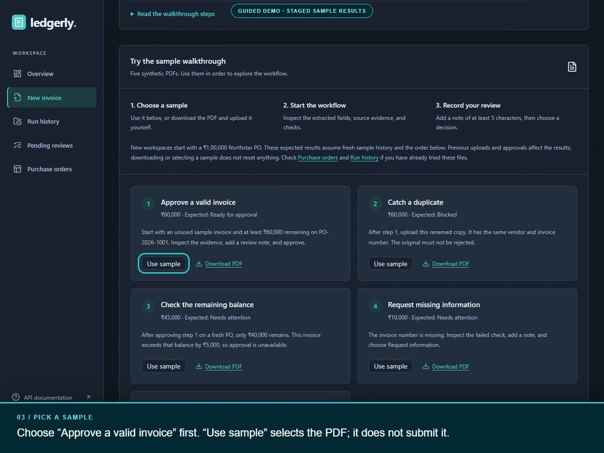
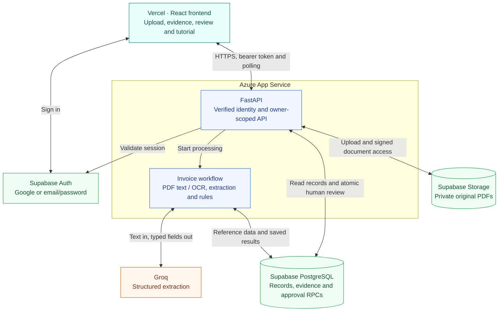
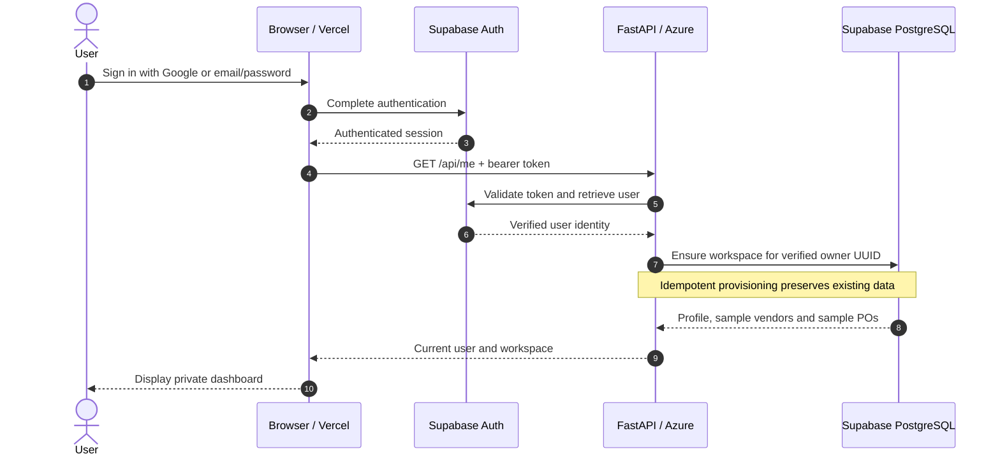
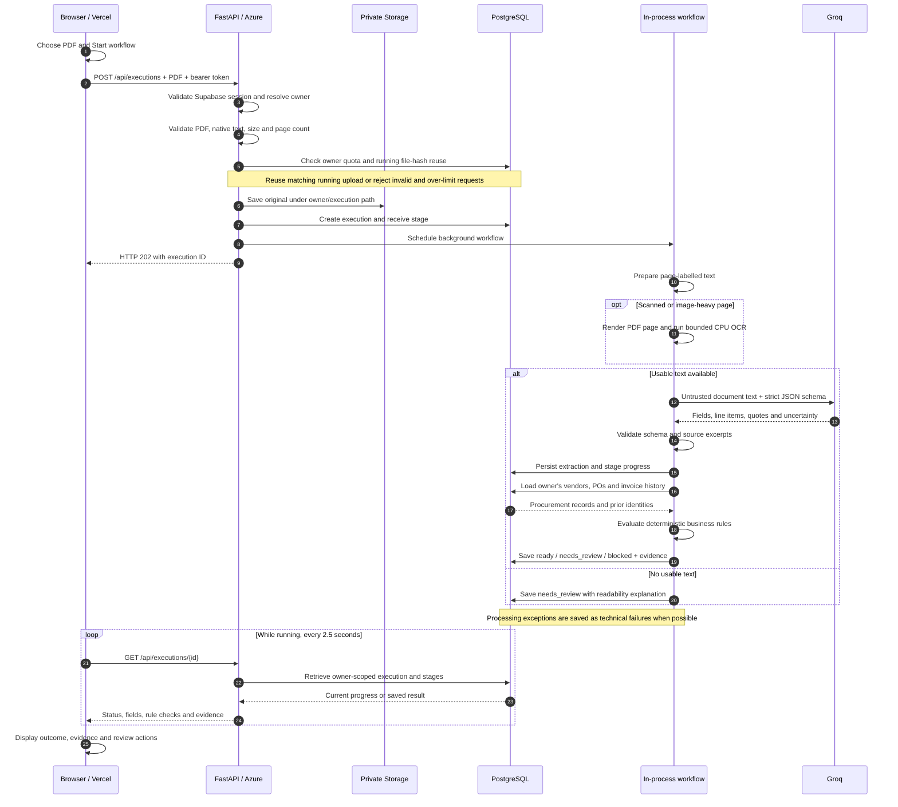
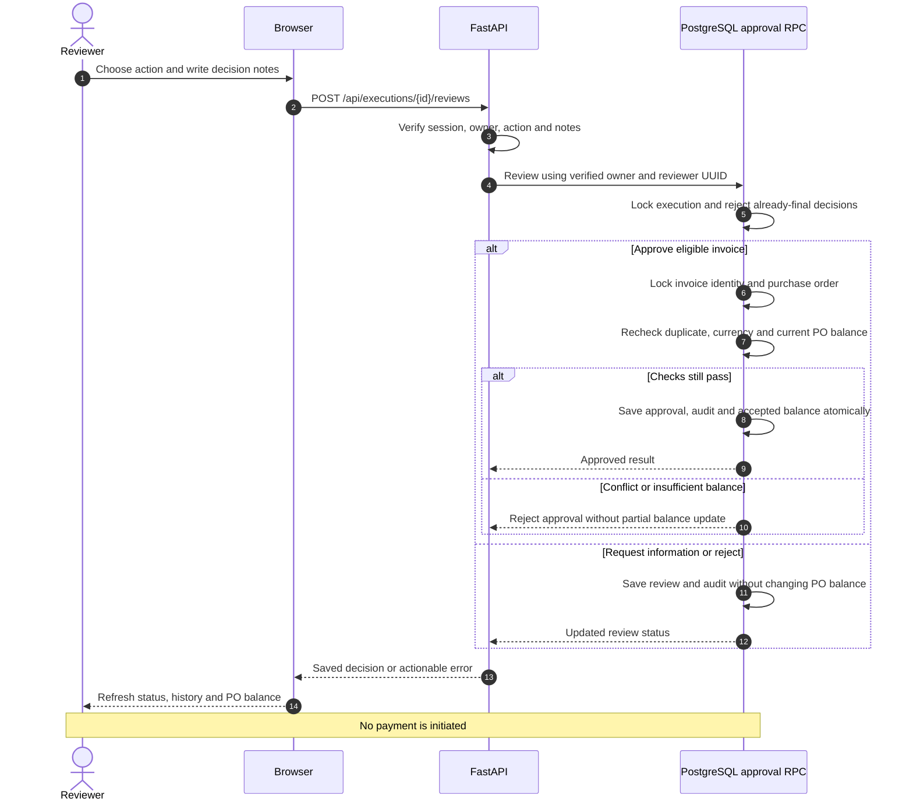
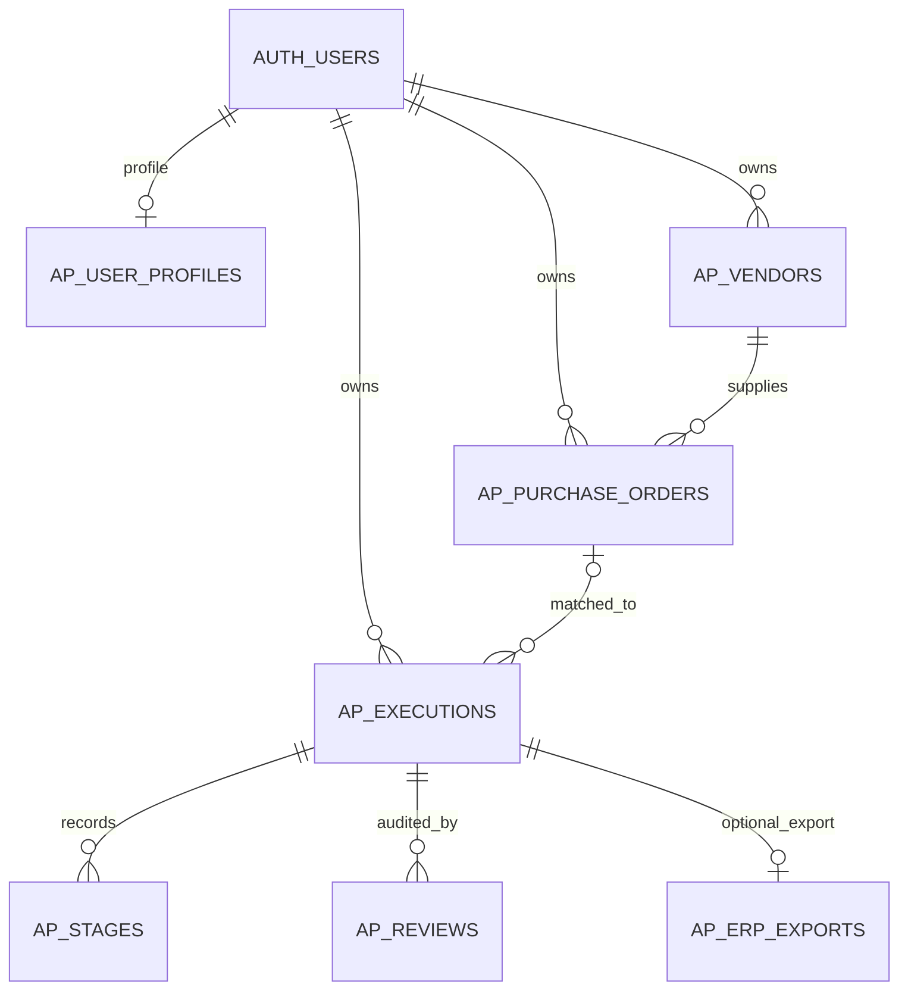
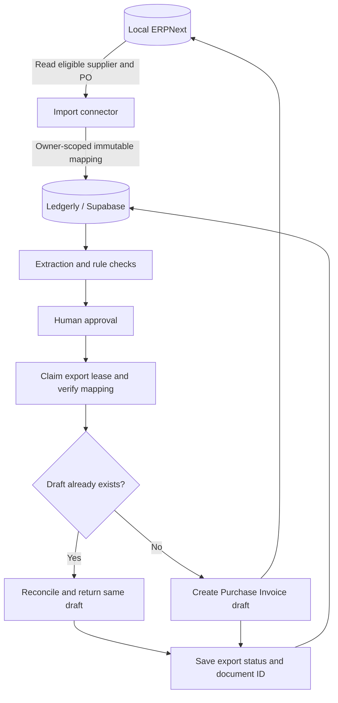

<div align="center">

# Ledgerly

### Every invoice. Every check. Every decision.

An AI-assisted accounts-payable workbench that turns invoice PDFs into traceable decisions—with human approval before a purchase-order balance changes.

**Built for PS-1 · Zamp AI Solutions Analyst case study**

[Live application](https://ledgerly-ai-invoice-review.vercel.app/) · [Watch the walkthrough](https://ledgerly-ai-invoice-review.vercel.app/assets/tutorial/ledgerly-walkthrough-narrated.mp4) · [API explorer](https://ledgerly-api-bobby-h3e4dnf4g3hsh9ej.centralindia-01.azurewebsites.net/docs) · [Download samples](https://ledgerly-ai-invoice-review.vercel.app/assets/samples/ledgerly-interview-samples.zip)


</div>

> **AI extracts. Rules validate. People approve.** Ledgerly records review decisions; it does not initiate payments.

[](https://ledgerly-ai-invoice-review.vercel.app/assets/tutorial/ledgerly-walkthrough-narrated.mp4)

*The 2-minute 48-second walkthrough includes AI narration, optional English subtitles, and written steps. Its synthetic, staged results explain the interface; live verification evidence is listed separately below.*

## Explore

[Problem](#the-problem) · [Demo](#try-the-demo) · [Features](#features) · [Architecture](#architecture) · [Request lifecycle](#request-lifecycle) · [Rules](#business-rules) · [Data and security](#data-and-security) · [ERPNext](#optional-local-erpnext-pilot) · [Setup](#run-your-own-instance) · [Deployment](#deployment) · [API](#api-reference) · [Verification](#verification) · [Limitations](#limitations-and-tradeoffs)

## The problem

An invoice arriving in accounts payable is not automatically safe to accept. Someone must identify the supplier, find the purchase order, check the arithmetic, detect duplicates, and confirm that earlier accepted invoices have not exhausted the PO balance. Missing information and ambiguous extraction need an explainable next step.

Ledgerly brings that process into one workspace:

1. **Read** a native or scanned invoice PDF.
2. **Extract** structured fields and source excerpts using Groq.
3. **Validate** against explicit rules, approved vendors, PO records, and invoice history.
4. **Explain** each check with evidence, a result, and the next action.
5. **Review** with a signed-in human decision and an audit trail.
6. **Update** the accepted PO balance atomically only when approval succeeds.

A workflow can complete successfully while its invoice is **blocked** or **needs attention**. A business exception is not a technical failure.

## Try the demo

1. Open [Ledgerly](https://ledgerly-ai-invoice-review.vercel.app/) and sign in with **Google** or a confirmed **email/password** account.
2. Your private workspace starts with sample vendors and purchase orders, zero accepted balances, and an empty invoice history.
3. Open **New invoice → Try the sample walkthrough**. Watch the quick tour or download the sample pack.
4. Choose **Use sample**, then **Start workflow**. Selecting a sample alone does not submit it.
5. Inspect the workflow, source evidence, and rule results. Add a decision note of at least five characters and approve, request information, or reject as appropriate.

### Reproduce the important scenarios

Use a workspace with fresh sample history for this sequence. Repeating a sample in an existing workspace can correctly trigger duplicate detection; the guide does not reset saved data.

| Sample | What to demonstrate | Expected result |
|---|---|---|
| [01 · Valid partial invoice](frontend/public/assets/samples/01-valid-partial-invoice.pdf) | Approve ₹60,000 against the ₹100,000 Northstar PO | Ready for approval, then **Approved**; ₹40,000 remains |
| [03 · Renamed duplicate](frontend/public/assets/samples/03-duplicate-renamed.pdf) | Upload the same vendor/invoice number under a different filename | **Blocked**; renaming cannot bypass business-identity checks |
| [04 · Partial-invoice overage](frontend/public/assets/samples/04-partial-invoice-overage.pdf) | After approving sample 01, submit ₹45,000 | **Needs attention**; exceeds the remaining ₹40,000 by ₹5,000 |
| [02 · Missing invoice number](frontend/public/assets/samples/02-missing-invoice-number.pdf) | Submit a document with required information missing | **Needs attention**; request a corrected document |
| [06 · Scanned invoice](frontend/public/assets/samples/06-scanned-invoice.pdf) | Submit an image-only ₹5,000 PDF | OCR reads the page before extraction; inspect the resulting checks |

The two exception demonstrations—missing required information and cumulative PO overbilling—are included alongside duplicate detection and OCR. All samples are synthetic. See [test instructions](frontend/public/assets/samples/TEST-INSTRUCTIONS.txt) and the [demo/recording guide](docs/DEMO_WALKTHROUGH.md).

**Where did an approved invoice go?** Pending reviews contains work awaiting a final decision. Approved records remain in **Run history** and the **Approved** dashboard filter; their accepted amount appears under **Purchase orders**.

## Features

| Area | Implemented behavior |
|---|---|
| Identity | Google OAuth, email/password, confirmation, password recovery, and logout through Supabase Auth |
| Private workspaces | Per-account sample POs, vendors, executions, review history, and document ownership |
| Document intake | PDF signature, size/page limits, encryption checks, private storage, and running-upload reuse |
| OCR | Native text first; bounded CPU OCR for scanned or image-heavy pages |
| AI extraction | Typed JSON, page references, source quotes, uncertainty flags, and bounded retries |
| Validation | Required fields, vendor/PO matching, duplicates, arithmetic, currency, and cumulative PO balance |
| Human review | Approve, request information, or reject; reviewer identity and notes recorded |
| Auditability | Six workflow stages, timestamps, model/policy metadata, checks, source PDF, and review history |
| Interface | Dashboard, search/status filters, invoice summary/detail, Light/Dark/System themes, responsive layout |
| Onboarding | Five sample PDFs, interview ZIP, narrated tutorial, subtitles, and written walkthrough |
| ERP extension | Separately tested **local ERPNext pilot** for PO import and approved-invoice draft export |

## Architecture

The public application uses **Vercel for the browser interface**, **Azure App Service for FastAPI and processing**, **Groq for extraction**, and **Supabase for identity, durable records, and private PDFs**.



The browser talks directly to Supabase **Auth**, but business records and private-document access go through the backend. Groq supplies extracted information; it does not choose approval outcomes or write purchase-order balances.

| Component | Responsibility |
|---|---|
| React 19 + TypeScript + Vite 7 | Screens, auth session, upload, polling, filters, review forms, theme preference |
| Tailwind CSS 4 + Lucide + owned UI components | Shared styling and interface primitives |
| FastAPI + Pydantic + HTTPX | Validated API boundaries, ownership, orchestration, provider calls |
| pypdf | Native text extraction and PDF validation |
| PDFium + RapidOCR / ONNX Runtime | CPU rendering and OCR without an external OCR service |
| Groq | Structured extraction with configured model `openai/gpt-oss-20b`; calls go to Groq, not a separate OpenAI API |
| Supabase PostgreSQL | Workspace records, evidence, review audit, transactional approval |
| Supabase Storage | Private original PDFs and short-lived signed links |
| Supabase Auth | User sessions and Google/email authentication |
| Azure / Vercel | Independently deployed backend and frontend |

## Request lifecycle

### 1. Sign in and create a private workspace



The backend derives the workspace owner from the verified session. A client cannot select another account simply by changing a URL or supplying a different owner ID.

### 2. Upload, extract, validate, and display the result



**This workflow runs inside the API process.** It is not an external durable worker queue. A deployment/restart can interrupt active work; stale runs are surfaced as interrupted rather than silently reported as successful.

| Stage | What happens |
|---|---|
| Receive invoice | Validate upload, retain private original, create execution |
| Extract invoice | Prepare native/OCR text, call Groq when readable, validate output and excerpts |
| Validate information | Record line items and uncertainty; prepare values for rule evaluation |
| Match purchase order | Read owner-scoped vendors, POs, and matching invoice history |
| Evaluate business rules | Compute explicit checks and select the business outcome |
| Save decision | Persist explanation, rule evidence, and completed execution |

### 3. A human reviews the invoice



Approval rechecks the **current** balance. A previously displayed “Ready for approval” result cannot bypass a later conflicting approval.

### How AI and OCR are bounded

- **AI output is data.** Documents are untrusted input. Extraction instructions require missing or ambiguous values to remain unknown and prohibit document instructions from controlling the workflow.
- **Structured output is validated.** Groq uses a strict JSON schema and temperature `0`. Pydantic and source-quote checks precede rule evaluation. An excerpt match supports traceability but does not guarantee correct interpretation.
- **Retries are limited.** At most two extraction calls are allowed for selected transient statuses with a bounded delay. There is no paid fallback or unlimited retry loop.
- **OCR is selective.** Pages with little native text or a large raster image are rendered with PDFium and read with RapidOCR. Page labels are retained for evidence.
- **OCR has execution limits.** A separate process, 90-second OCR timeout, one document at a time, one inference thread, and a 2,000-pixel maximum rendered side bound processing. The full workflow has a 180-second timeout.
- **Uncertainty stays visible.** Low OCR scores or unresolved evidence can route an invoice to review. A blank document does not become an invented invoice.

See [OCR behavior and measurements](docs/OCR.md), [extraction services](backend/app/services), and [workflow orchestration](backend/app/workflow.py).

## Business rules

The usual complete sample produces 11 checks; additional uncertainty/readability conditions can change the count. All amounts use decimal arithmetic.

| Check | Policy |
|---|---|
| Required information | Vendor name, invoice number/date, PO reference, currency, subtotal, tax, and total must be present |
| Invoice date | Valid date, not in the future |
| Source evidence | Critical values require usable document evidence; uncertainty stays visible |
| Approved vendor | Unique normalized match in the workspace's approved vendor register |
| Vendor identifier | Compare tax identifiers when both invoice and vendor provide them |
| Purchase-order match | Explicit PO must be open and belong to the matched vendor |
| Duplicate invoice | A prior completed, non-rejected invoice with the same normalized vendor and number blocks acceptance |
| Invoice arithmetic | Nonnegative subtotal/tax, positive total, and subtotal + tax reconciliation within 0.01 |
| Line-item reconciliation | When supplied, nonnegative line amounts must sum to pretax subtotal within 0.01 |
| Currency agreement | Invoice and PO currencies must match; no implicit conversion |
| Remaining PO balance | Gross invoice must fit within PO amount minus previously accepted gross invoices; no overbilling tolerance |

Three state layers are deliberately preserved:

| State layer | Examples | Meaning |
|---|---|---|
| Execution | Running, completed, failed/interrupted | Did processing finish? |
| Automated outcome | Ready, needs review, blocked | What did the document and business checks conclude? |
| Human review | Pending, information requested, approved, rejected | What did the reviewer decide? |

Blocking checks take precedence over review exceptions. Approval is unavailable until the invoice is eligible; a reviewer can still request information or reject a completed exception. Corrected documents are resubmitted rather than silently rewriting saved evidence.

Source of truth: [business rules](backend/app/services/rules.py), [policy rationale](docs/DECISIONS.md), and [atomic workspace review functions](database/migrations/002_private_workspaces.sql).

## Data and security

### Logical data model



| Stored record | Purpose |
|---|---|
| Profile | Auth UUID, email, display name, workspace identity |
| Vendor and PO | Supplier identity, approval flag, currency, gross amount, accepted balance, optional ERP mapping |
| Execution | Owner, document location/hash, fields, model/policy metadata, evidence, outcome, review status, timestamps |
| Stage | Processing step, status, timing, explanation |
| Review | Action, comment, reviewer identity/UUID, timestamp |
| ERP export | Optional draft ID, status, attempts, error, retry lease |

- **Session validation:** protected routes validate bearer tokens through Supabase Auth and require a confirmed, non-anonymous account.
- **Owner boundaries:** backend queries, RPC inputs, and composite ownership constraints scope records to the authenticated user. Another account's execution URL does not reveal its record.
- **Database access:** business tables have RLS enabled and direct `anon`/`authenticated` grants revoked. The service-role credential is privileged, so explicit owner checks remain essential; RLS alone is not the service-role boundary.
- **Private documents:** the API checks ownership before issuing a signed PDF URL valid for 120 seconds. Anyone holding that link can use it until expiry.
- **Secret separation:** service-role, Groq, ERP, SMTP, and OAuth client secrets stay out of browser bundles and Git. Only public configuration belongs in `VITE_*` settings.
- **Review integrity:** execution/PO locks, duplicate guards, and one transaction protect review records and accepted balances from partial updates.
- **Intake limits:** defaults are 5 MB, five PDF pages, 20,000 extracted characters, ten accepted uploads per owner per rolling 24 hours, and two active workflows per API process.
- **Legacy access:** shared demo/reviewer codes are an optional migration bridge, disabled by default. Recruiters use Supabase login and private workspaces.

Application tables do not store plaintext passwords. Public [privacy](https://ledgerly-ai-invoice-review.vercel.app/privacy/) and [terms](https://ledgerly-ai-invoice-review.vercel.app/terms/) pages describe the demo. Use synthetic documents for evaluation.

## Optional local ERPNext pilot

**ERPNext is an open-source ERP used here as a downstream procurement/accounting demo. It is not required to use the public application.** The pilot runs locally in Docker, connects one explicitly selected Ledgerly workspace, imports PO reference data, and exports approved invoices as ERPNext **drafts**.



The verified pilot supports **single-line, non-stock, untaxed INR POs without discounts**. It checks eligibility, uses an execution identifier to prevent duplicate drafts, and reconciles existing drafts on retry. Export does not increment the accepted PO balance again. The integration user cannot submit the invoice or initiate payment.

The real-data test imported `PUR-ORD-2026-00001`, processed synthetic invoice `ERP-LIVE-20261104-001` for ₹10,000, received human approval through Ledgerly, and exported draft `ACC-PINV-2026-00002`. Repeated export returned the same draft. A separate adapter test exercised lost-acknowledgement recovery and rejection of unapproved export.

**Public deployment:** `VITE_ENABLE_ERPNEXT=false`; local ERP controls are hidden. Azure cannot connect to a laptop's loopback address. This repository does not claim an always-online, publicly hosted ERP service.

See [local setup and constraints](docs/ERP_NEXT_SETUP.md), [real workspace verification](docs/erpnext-workspace-check-results.json), [adapter verification](docs/erpnext-live-check-results.json), and [ERP migration](database/migrations/003_erpnext.sql).

## Run your own instance

Prerequisites: Python 3.13, a Node.js version supported by Vite 7, a Supabase project, and a Groq API key. Docker is only needed for the optional ERP pilot.

### 1. Install dependencies

```powershell
git clone https://github.com/rock917/ledgerly-ai-invoice-review.git
cd ledgerly-ai-invoice-review
python -m venv .venv
.\.venv\Scripts\python.exe -m pip install -r backend/requirements-dev.txt
npm.cmd ci --prefix frontend
```

### 2. Prepare Supabase

For a **new project**, run these in order in the SQL Editor:

1. [database/schema.sql](database/schema.sql)
2. [database/seed.sql](database/seed.sql)
3. [002_private_workspaces.sql](database/migrations/002_private_workspaces.sql)
4. Optional ERP only: [003_erpnext.sql](database/migrations/003_erpnext.sql)

For existing installations, apply only missing migrations; do not reset history to reproduce a demo. Confirm the private `ap-invoices` bucket and configured upload restrictions.

Configure Supabase Authentication:

- Enable email/password and configure SMTP for confirmation/recovery emails. The demo uses Gmail SMTP with an app password, subject to sender delivery limits.
- Enable Google using an **OAuth client ID and client secret**, not a Gmail address or SMTP app password.
- Register your Supabase `/auth/v1/callback` URL as the Google client's authorized redirect URI.
- Set the application's Site URL and allow `/auth/callback` and `/auth/reset`. Include localhost equivalents when developing.
- Make Google OAuth available to your intended audience after completing consent configuration.

Detailed provider setup: [AUTH_SETUP.md](docs/AUTH_SETUP.md).

### 3. Configure environment variables

Copy these templates once for a fresh checkout, then fill values locally. Preserve any existing configured environment files.

```powershell
Copy-Item backend/.env.example backend/.env
Copy-Item frontend/.env.example frontend/.env
```

| Location | Variable | Value/purpose |
|---|---|---|
| Backend | `SUPABASE_URL` | Supabase project URL |
| Backend | `SUPABASE_SERVICE_ROLE_KEY` | Server-only privileged key |
| Backend | `SUPABASE_STORAGE_BUCKET` | `ap-invoices` |
| Backend | `GROQ_API_KEY` | Server-only Groq credential |
| Backend | `GROQ_MODEL` | Configured model; example: `openai/gpt-oss-20b` |
| Backend | `CORS_ORIGINS` | Comma-separated exact frontend origins |
| Backend | `APP_ENV` | `development` locally, `production` on Azure |
| Backend | `ENABLE_LEGACY_DEMO` | Keep `false` for account-based access |
| Frontend | `VITE_API_URL` | `http://localhost:8001` locally; HTTPS Azure URL in production |
| Frontend | `VITE_SUPABASE_URL` | Supabase project URL |
| Frontend | `VITE_SUPABASE_PUBLISHABLE_KEY` | Public browser key; never service-role/secret key |
| Frontend | `VITE_ENABLE_ERPNEXT` | `false` for public demo |

Limits and optional ERP variables are in the [backend template](backend/.env.example) and [frontend template](frontend/.env.example). Vercel's public `VITE_*` values become part of the browser build.

### 4. Start the API and frontend

From the repository root, in one terminal:

```powershell
.\.venv\Scripts\python.exe -m uvicorn app.main:app --app-dir backend --host 127.0.0.1 --port 8001
```

In another:

```powershell
npm.cmd run dev --prefix frontend
```

Open the frontend URL printed by Vite. Check `/health` and API `/docs`, then sign in to provision the workspace. A healthy process does not prove Groq/database operations succeed; verify an actual sample workflow too.

## Deployment

| Service | Deployed role | Configuration |
|---|---|---|
| Vercel | Frontend, samples, tutorial, captions, privacy/terms | Root `frontend`; Vite; build `npm run build`; output `dist`; public build variables |
| Azure App Service | FastAPI, PDF extraction, CPU OCR, background workflows | Linux, Python 3.13, B1, one instance/worker; server variables |
| Supabase | Auth, workspace database, private PDFs | SQL migrations, auth providers, redirects, SMTP, storage settings |
| Groq | Invoice extraction | Backend-only API key and configured model |
| Local Docker | Optional ERPNext | Local availability; outside public application's dependency path |

### Frontend: GitHub → Vercel

Vercel is connected to `main`. Push frontend changes, wait for production deployment, and verify the public URL. Environment-variable changes require a new build. Set backend `CORS_ORIGINS` to the exact production origin, such as `https://ledgerly-ai-invoice-review.vercel.app`, without a trailing slash.

### Backend: package → Azure

The backend deploys separately; a GitHub push does **not** automatically update Azure in this setup.

```powershell
.\.venv\Scripts\python.exe scripts/package_backend.py
```

This creates `tmp/deploy/ledgerly-backend.zip` with application code and requirements, excluding local secrets and development artifacts. Upload it to Cloud Shell, then deploy:

```bash
az webapp deploy \
  --resource-group ledgerly-api-bobby_group \
  --name ledgerly-api-bobby \
  --src-path "$HOME/ledgerly-backend.zip" \
  --type zip \
  --timeout 1200000 \
  --output none
```

Azure settings include `SCM_DO_BUILD_DURING_DEPLOYMENT=true`, backend variables, HTTPS, and Always On. Startup command:

```bash
python -m uvicorn app.main:app --host 0.0.0.0 --port 8000 --workers 1
```

Apply database migrations before code that depends on them. Deploy when no workflows are active, then check health, authentication, a complete sample, and frontend access. See [deployment instructions](docs/AZURE_DEPLOYMENT.md).

**Cost model:** Vercel/Supabase/Groq free-tier access and Azure student credits. Azure B1 consumes credits and is not permanently free. Provider quotas apply; ERPNext stays local to avoid another hosted service. These are project choices, not unlimited-free-usage guarantees.

## API reference

Schemas are in the [live FastAPI explorer](https://ledgerly-api-bobby-h3e4dnf4g3hsh9ej.centralindia-01.azurewebsites.net/docs). Business routes require authentication and use the verified workspace.

| Method | Route | Purpose |
|---|---|---|
| GET | `/health` | Process/configuration health; not full provider connectivity |
| GET | `/api/me` | Verified identity and workspace provisioning |
| GET | `/api/readiness` | Readiness checks; AI configuration is not an inference test |
| GET | `/api/dashboard` | Metrics and recent executions |
| POST | `/api/executions` | Submit PDF; HTTP 202 with execution ID |
| GET | `/api/executions` | Search/filter paginated history or pending reviews |
| GET | `/api/executions/{id}` | Execution, extraction, stages, checks, reviews |
| GET | `/api/executions/{id}/document` | Authorized short-lived PDF link |
| POST | `/api/executions/{id}/reviews` | Approve, request information, or reject |
| GET | `/api/purchase-orders` | PO amounts, accepted and remaining balances |

<details>
<summary><strong>Optional ERPNext routes</strong></summary>

These require the configured pilot workspace and a reachable ERPNext instance.

| Method | Route | Purpose |
|---|---|---|
| GET | `/api/erpnext` | Connection/capability status |
| POST | `/api/erpnext/purchase-orders` | Import an eligible ERP PO |
| GET | `/api/executions/{id}/erpnext` | Export tracking status |
| POST | `/api/executions/{id}/erpnext` | Create or reconcile an approved invoice's draft |

</details>

## Verification

The latest recorded backend regression run passed **96 tests**. Evidence separates local/mock checks from real-provider and owner-reported checks. This is a release record, not a claim of continuous monitoring.

| Evidence | What was checked | Boundary |
|---|---|---|
| [Backend tests](backend/tests) | Rules, auth/ownership, upload/workflow, review and ERP guards | Controlled provider doubles |
| [Database tests](database/tests) | Actual migration SQL, ownership constraints, approval/balance guards, export leases | PGlite; not a production load/concurrency benchmark |
| [Frontend tests](frontend/tests) | Auth, samples, review gating, filters, themes, responsive and ERP UI | Mock APIs where specified |
| [Azure OCR report](docs/azure-ocr-check-results.json) | Real scanned PDF completed on Azure with all 11 checks passing | One run, approximately 35.7 seconds; not a latency guarantee |
| [Production UI report](docs/production-ui-check-results.json) | Browser checks against deployed UI/API | Bounded release smoke checks |
| [Auth report](docs/auth-deployment-check-results.json) | Login rollout, owner-reported Google/email/recovery and isolation checks | Manual checks, not a comprehensive security audit |
| [ERP workspace report](docs/erpnext-workspace-check-results.json) | Real PO import, Supabase/Groq workflow, human approval, draft export/reuse | Local pilot only |
| [ERP adapter report](docs/erpnext-live-check-results.json) | Real ERP calls with controlled Ledgerly adapter; retries and rejection | Separate from real-workspace test |
| [Release notes](docs/PROGRESS.md) | Sample/tutorial release, playback/captions, deployed media and range checks | Historical entries describe earlier releases too |

Run the main local checks:

```powershell
.\.venv\Scripts\python.exe -m pytest backend/tests -q
npm.cmd ci --prefix database/tests
npm.cmd test --prefix database/tests
node database/tests/erpnext.test.mjs
npm.cmd run build --prefix frontend
```

Browser scripts and server/fixture requirements live in [frontend/tests](frontend/tests). Live provider checks require credentials and can create synthetic records; review scripts before running against a shared project.

## Limitations and tradeoffs

- **Demo orchestration:** in-process jobs, two active workflows per process. A durable queue, multi-instance coordination, and sustained-load testing would be needed before scaling.
- **Document scope:** PDF only; default five-page/5-MB limits. OCR quality varies with resolution, layout, and scan quality. Handwriting and complex tables are not guaranteed.
- **Resource bounds:** time, image-size, and concurrency limits exist, but there is no hard per-job memory cap. One successful Azure scan is not a capacity benchmark.
- **AI uncertainty:** source verification and typed output reduce unsupported extraction but do not eliminate errors. Human review and deterministic checks remain necessary.
- **Procurement assumptions:** invoice-to-PO validation, not three-way matching with goods receipts. Tax IDs are compared with reference records, not government registries.
- **Corrections:** request corrected information and resubmit; there is no full document-edit/resolution workflow.
- **ERP scope:** a narrow local draft-export pilot, not general multi-tenant ERP synchronization or payment execution.
- **Availability:** quotas, credit expiry, email delivery limits, model availability, and provider outages can affect the demo.

## Repository map

```text
ledgerly-ai-invoice-review/
├── backend/
│   ├── app/                  Routes, auth, workflow, models and services
│   ├── tests/                Backend regression checks
│   └── .env.example          Server configuration template
├── frontend/
│   ├── src/                  Screens, components, auth and API client
│   ├── public/assets/        Samples, tutorial video, captions and poster
│   ├── tests/                Browser checks
│   └── .env.example          Public configuration template
├── database/
│   ├── schema.sql            Base schema and review logic
│   ├── seed.sql              Synthetic procurement reference data
│   ├── migrations/           Private workspaces and ERP extension
│   └── tests/                Executable SQL/migration checks
├── sample_data/              Scenarios and sample sources
├── scripts/                  Packaging and demo utilities
└── docs/                     Setup, tradeoffs and verification records
```

## Further reading

- [Demo walkthrough and recording outline](docs/DEMO_WALKTHROUGH.md)
- [Business decisions and tradeoffs](docs/DECISIONS.md)
- [Authentication setup](docs/AUTH_SETUP.md)
- [OCR implementation and evidence](docs/OCR.md)
- [Deployment guide](docs/AZURE_DEPLOYMENT.md)
- [Local ERPNext setup](docs/ERP_NEXT_SETUP.md)
- [Sample scenarios](sample_data/SCENARIOS.md)

Diagrams use native [GitHub Mermaid rendering](https://docs.github.com/en/get-started/writing-on-github/working-with-advanced-formatting/creating-diagrams), keeping architecture and request sequences readable and editable alongside the code.
