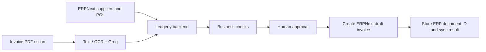

# ERPNext demo integration plan

Historical planning document. The connector is now implemented locally; follow [ERP_NEXT_SETUP.md](ERP_NEXT_SETUP.md) for current setup, limits, tests and rollout order. The original plan below is retained as design context and is not a deployment status report.

## What ERP integration means here

An ERP is the company's central system for purchasing, suppliers, inventory, and accounting. Ledgerly handles the invoice-reading and review work. Integration would let it read procurement records from ERPNext and create an ERPNext **draft Purchase Invoice** after a person approves an invoice in Ledgerly.

ERPNext distinguishes a Purchase Order, Purchase Receipt, Purchase Invoice, and Payment Entry. They represent different steps; a Ledgerly approval must not silently become an accounting submission or payment. [ERPNext buying overview](https://docs.frappe.io/erpnext/buying)



## 1. Start with a local disposable demo

Use the official Frappe Docker demo on a machine with Docker and Compose v2. Keep it separate from the Ledgerly repository. This proves the mapping before using Azure credits for another service. The upstream `pwd.yml` is explicitly a disposable evaluation setup. [Official setup](https://github.com/frappe/frappe_docker)

Planned commands, after Docker is available:

```powershell
git clone https://github.com/frappe/frappe_docker E:\ERPNext-demo
cd E:\ERPNext-demo
git rev-parse HEAD
```

Record that revision. Inspect `pwd.yml` and change the frontend host port binding to `127.0.0.1:8080:8080` so the evaluation service is local-only. Then:

```powershell
docker compose -f pwd.yml up -d
docker compose -f pwd.yml logs create-site
```

Wait for successful site creation, then open `http://localhost:8080`. The upstream disposable demo initially uses Administrator/admin; change that password immediately. Keep demo credentials out of the repository. Do not expose this disposable configuration publicly.

Local FastAPI can reach local ERPNext. The Azure backend cannot use your computer's `localhost`; a public integration needs a separate reachable deployment. If we later choose Azure, prepare a separate resource group, production Compose configuration, persistent volumes, HTTPS and backups; verify its estimate against the remaining student credits before provisioning. Do not reuse or alter the DocuMind VM for this plan.

## 2. Create reference data and a limited API user

- Create a synthetic company using INR, a supplier, one item with a unit of measure, expense account and cost center, and a submitted PO.
- Use fresh ERP demo identifiers. Map ERP supplier/PO/item IDs explicitly to Ledgerly reference records; do not assume matching display names establish identity.
- Create a dedicated integration user with the permissions needed to read the reference documents and create/read draft Purchase Invoices. Do not give it payment or invoice submission rights.
- Generate its API key/secret and store them only in backend environment settings. Test the authenticated identity and document reads first. Frappe's REST API supports token authentication and document creation. [API documentation](https://docs.frappe.io/framework/user/en/api/rest)

## 3. Implement the connector after the test site exists

1. Read ERP reference records and record their IDs and refresh time. Define ERPNext as the authority for procurement data; distinguish Ledgerly's pending commitments from ERP-posted amounts to avoid double counting.
2. Add an explicit **Send approved invoice to ERP** action. The backend rechecks final approval, supplier, currency, amounts and PO line mappings.
3. Create a draft Purchase Invoice with the supplier bill number/date, company, PO line references, quantities/rates, account/cost center and tax mapping. Do not infer these accounting mappings from invoice prose. Compare ERP-calculated totals with the approved total. [Purchase Invoice fields and lifecycle](https://docs.frappe.io/erpnext/purchase-invoice)
4. Store a unique Ledgerly execution reference on the ERP document and a sync record in Supabase. Lock exports locally and enforce uniqueness at the destination. After an ambiguous network timeout, look up that reference before retrying.
5. Show pending/synced/failed state, the real ERP document ID and a retry action. Never display success without a verified ERP response. Never auto-submit a draft or create a Payment Entry.

## 4. Acceptance checks

Verify reference reads, one approved invoice creating one draft, repeated clicks/retries producing no duplicates, rejection of unapproved invoices, mismatched totals, revoked credentials and timeouts. Confirm the ERP document remains a draft and no payment or accounting submission occurred. Record the actual site/version and results before claiming integration is live.

Next prerequisite: a local ERPNext demo and its reference records. This plan does not require buying a hosted ERP subscription.
